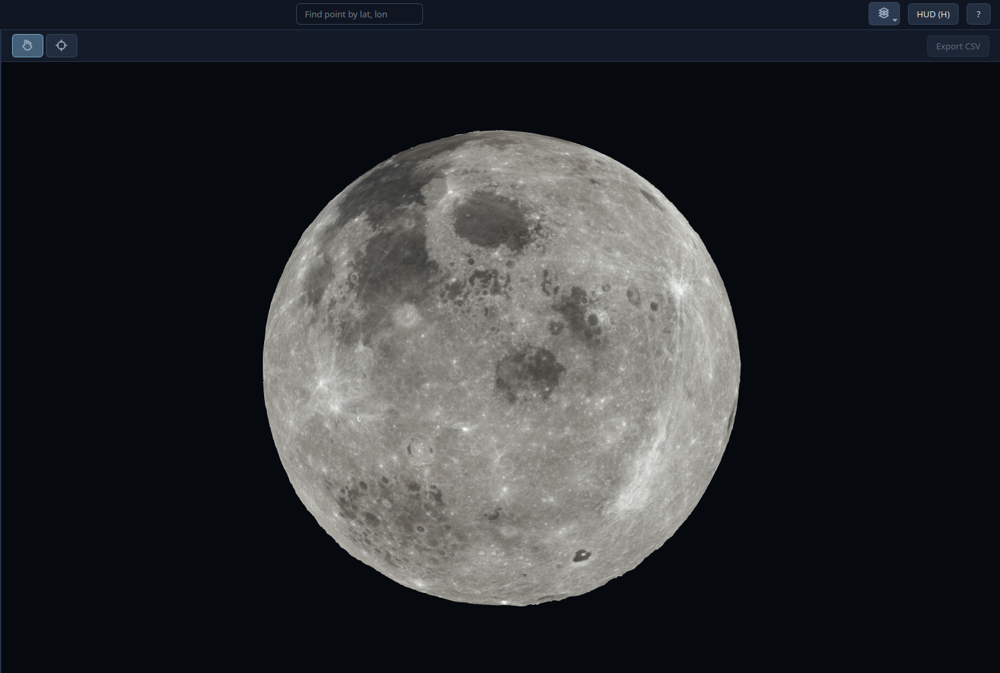
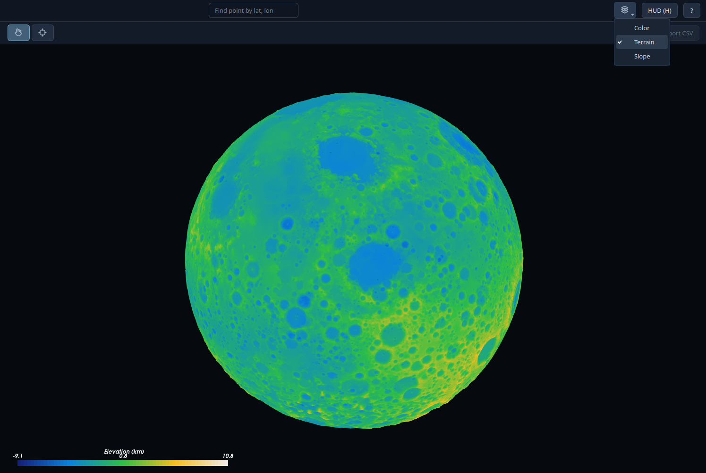
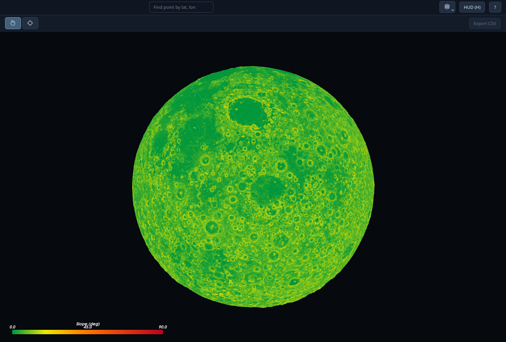
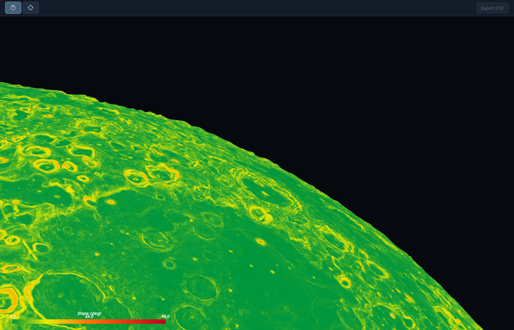
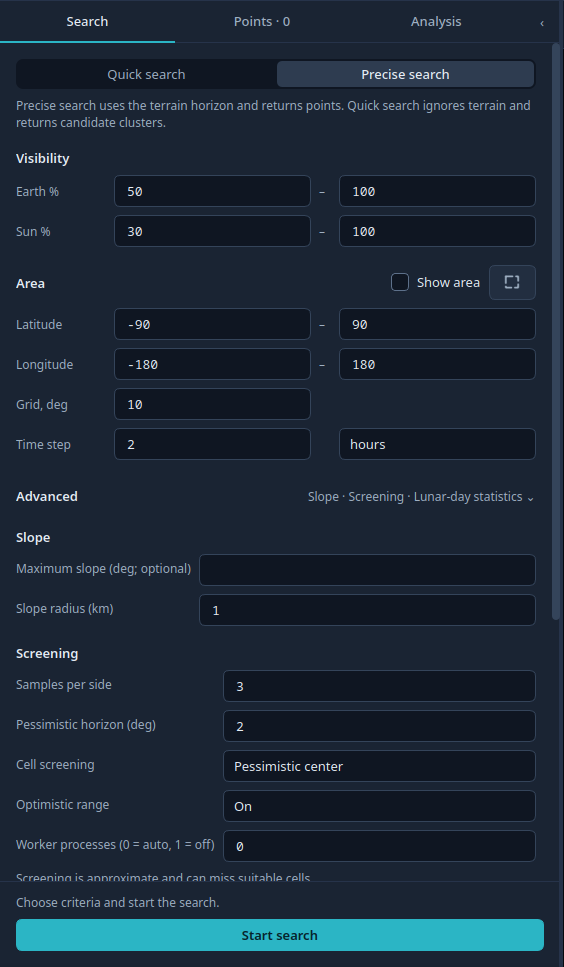
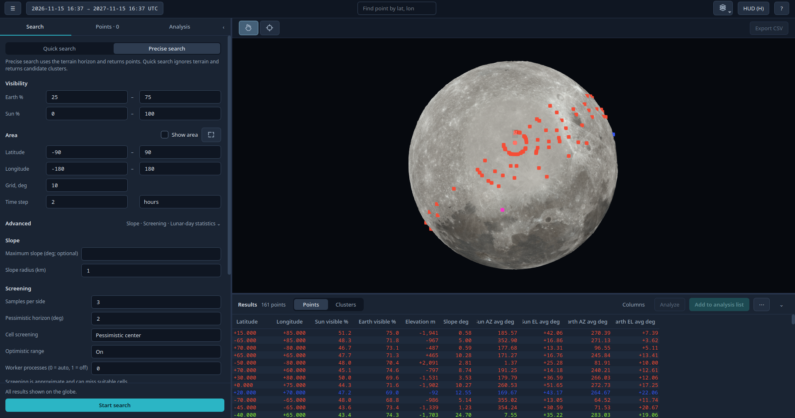
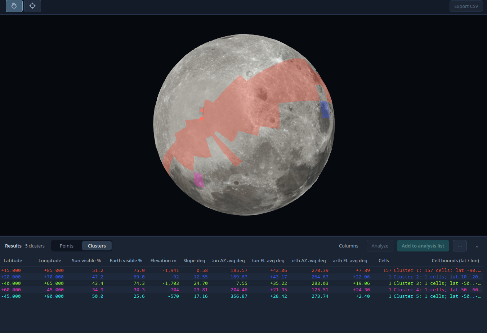
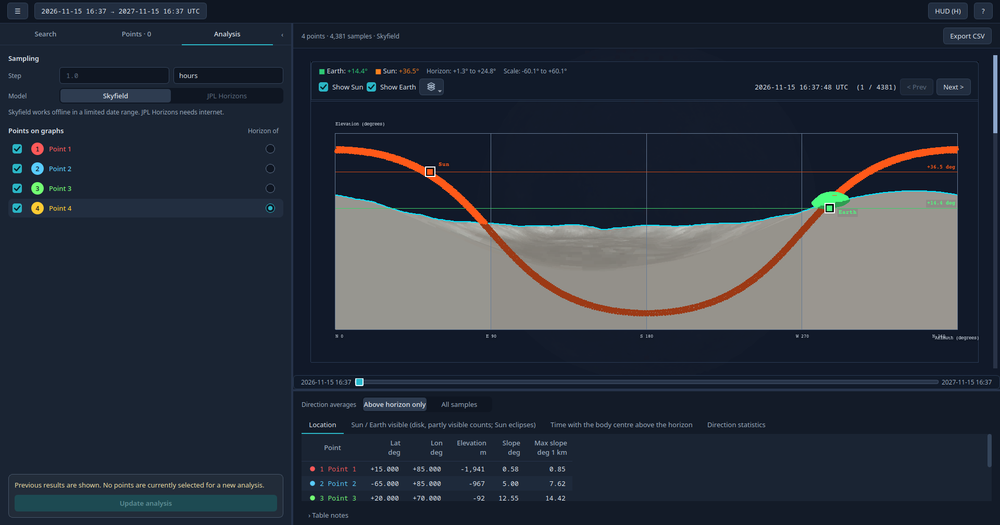

To launch this program
``` bash
pip install -r requirements.txt
python moon.py
```

This program has 3 main parts:

1. A globe of the Moon.You have 3 different types of globes available: a color globe that shows the Moon as you would see it with your eyes, a topographical globe, and a slope globe that allows you to see where the terrain is uneven.

   
   
   

   The globe’s mesh is consistent with topographical data; you can freely rotate and explore it. All textures for the globe are either downloaded from NASA web pages or computed on the device. 

   
   
   You can use 2 tools in the globe window, located right above it:
   - Hand allows you to select points/areas generated with Search (see below).
   - With Add, you can select new points by clicking the terrain; you can add your points to the analysis list with a button on the right. You will also see the horizon lines for the last selected point.

     


2. Search. With the Search window, you can set certain criteria, like the area of search, the percentage of time when the Sun or the Earth is visible, the maximum slope in a specified radius, and others. 

   

   A quick search will show you the approximate area or clusters where these criteria can be satisfied. A precise search will show you some of the points in the area that satisfy the criteria. The precision of the search also depends on the grid field, which defines how many points/areas will be calculated. After the search is done, points/clusters will be visualized on your globe. You will also be presented with a table of points and their characteristics in columns. You can hide/show columns, sort by them, and add points to the analysis list. Under the hood, Search does restricted analysis for every point in the grid and filters them by criteria, it uses the same models as Analysis.
   
   
  
3. Analysis. In the Analysis window, you can see and compare visualized data on points you added to your analysis list. You can select one of 2 models:
- Skyfield is local, but it requires you to download some data from NASA services when you first use it (you only install it once).
- JPL Horizons requests data from a web API; it takes more time, but doesn't take any space. After the analysis is complete, you will be presented with information about selected points. The first graph shows the horizon “panorama” graph with Sun and Earth trajectories for a selected point (trajectories may “squish” the horizon graph; if you want to see a normal graph, uncheck the “show sun/earth” checkboxes). Other graphs are described in their titles. You can use a scroll bar (right above the graphs window) to scroll through samples in time. Under the graphs, you can find multiple tables, which can also be used to compare points.


Our application is easy to use and flexible; it helps with both the search for potential landing sites and their comparison. Some data is visualized in a way that helps understand some lunar phenomena and account for them when planning a lunar landing mission.

This project is programmed with the Python programming language because it is the perfect language for fast prototyping and it has access to many useful libraries. We used PySide6 to use the Qt framework for the user interface, VTK for 3D rendering, astroquery to query JPL data, skyfield to calculate the same data as JPL locally, Pillow to process terrain textures, and numpy for calculations.
